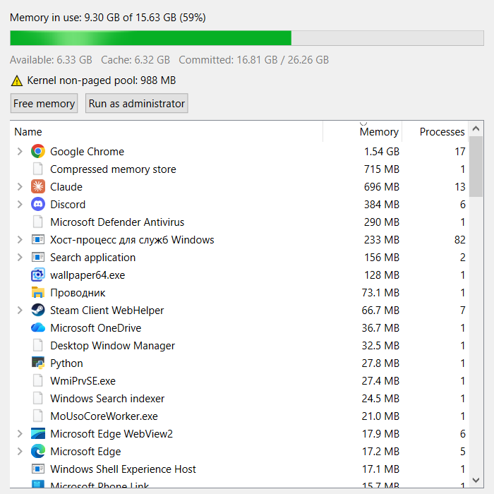

# RamScope

A small Windows 10/11 tool: shows what fills your RAM and frees it with one button.



**Download:** [RamScope.exe](https://github.com/KosmmoSttars/ramscope/releases/latest/download/RamScope.exe):
a portable single file. No install, no Python needed, nothing written to the registry or disk.

- **Memory in use**: a bar, plus available memory, file cache and commit charge.
- **App list**: every app with its private memory (the same figure Task Manager shows), grouped by
  executable. Expand a row to see each process. Right-click: free its memory, end task, open file location.
- **Warnings** appear above the buttons when something is wrong: an app taking a big share of RAM,
  an app that keeps growing (a leak), a driver leak in the kernel pool, commit charge near its limit.
  Hover a warning for an explanation and advice.

## Free memory

Trims the working sets of all processes. Their idle pages leave RAM, so "in use" drops. With
**Run as administrator** it also trims system processes, flushes modified pages and drops stale file
cache. An app that needs a trimmed page again gets it back, which can cost a brief slowdown, so it
helps most right before launching something heavy.

## Run

```
pip install -r requirements.txt
python main.py
```

Build a single `RamScope.exe`: `python tools/build.py`.
